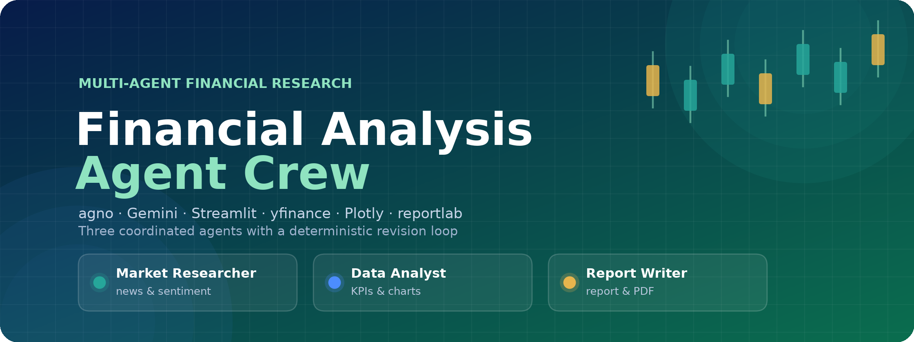
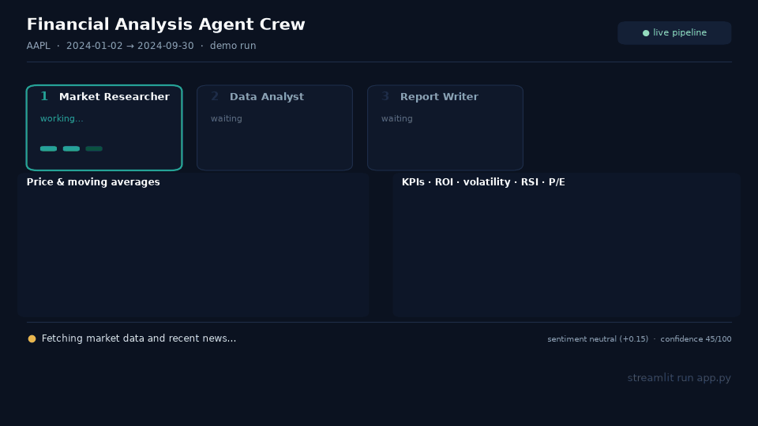
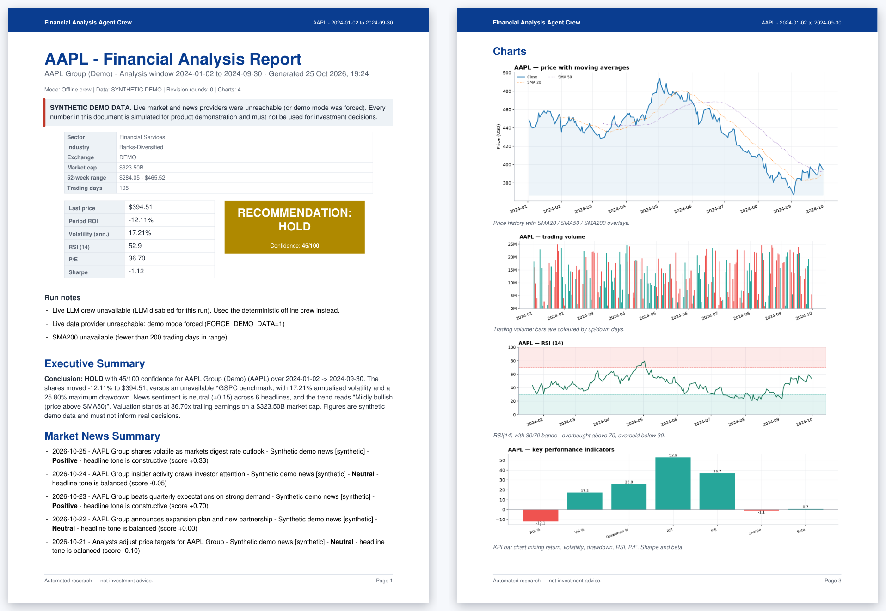
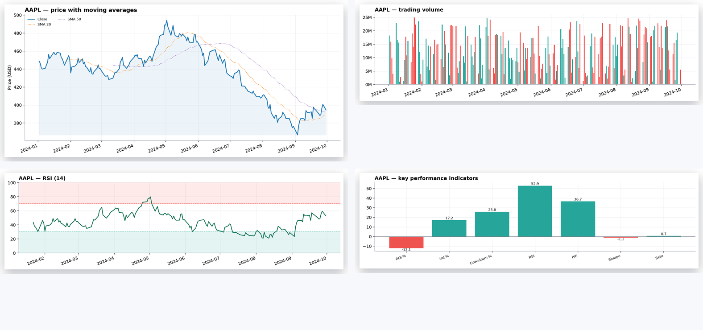
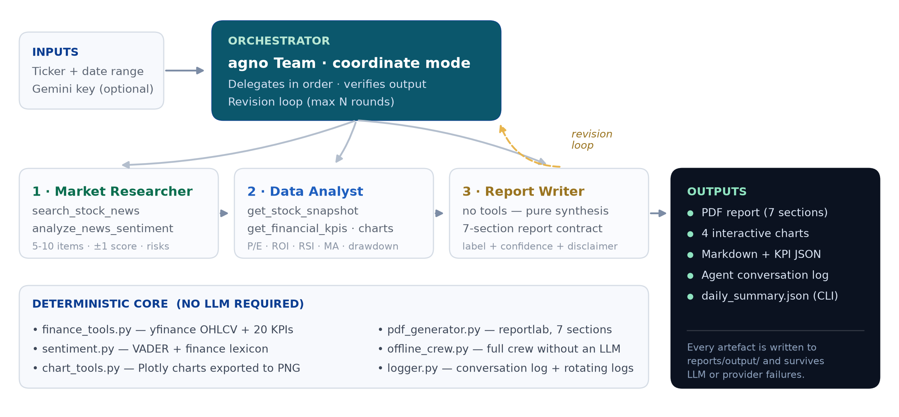

<div align="center">



<br>
<br>

<b>Three specialised AI analysts — a news researcher, a quantitative analyst and a report writer — coordinated by an orchestrator that reviews its own work.</b>

Give it a ticker and a date range. Get back a news + sentiment brief, a full KPI analysis, interactive charts, and a print-ready PDF.

<br>

<a href="https://www.python.org/"></a>
<a href="https://github.com/agno-agi/agno"></a>
<a href="https://ai.google.dev/"></a>
<a href="https://streamlit.io/"></a>
<a href="#-testing--code-quality"></a>
<a href="#-testing--code-quality"></a>
<a href="#-testing--code-quality"></a>
<a href="#-docker"></a>

<a href="#-quick-start"><b>Quick start</b></a> ·
<a href="#-watch-one-analysis-run"><b>Demo</b></a> ·
<a href="#-architecture"><b>Architecture</b></a> ·
<a href="#-agent-prompts--report-contract"><b>Prompts</b></a> ·
<a href="#-command-line--automation"><b>CLI</b></a> ·
<a href="#-docker"><b>Docker</b></a>

</div>

---

## 📽️ Watch one analysis run

<div align="center">



<br>
<sub>Offline demo run — deterministic synthetic data, no API key. The real UI adds progress bars, six result tabs and downloads.</sub>

</div>

---

## 📄 What you get

<div align="center">



<br>
<sub>A real generated report — cover with company facts, recommendation badge and confidence bar (left), and the chart page (right).</sub>

</div>

<br>

<div align="center">



<br>
<sub>Every run produces four charts: price with SMA20/50/200, volume coloured by up/down days, RSI(14) with 30/70 bands, and a KPI comparison — exported to PNG for the PDF and served interactively in the UI.</sub>

</div>

---

## ✨ Why this one is different

| | |
| --- | --- |
| 🧠 **Agents that check their own work** | The orchestrator reviews the draft against a hard contract — headings, recommendation label, confidence score, 10+ cited figures, sentiment/price reconciliation — and sends it *back* to the writer with specific instructions, up to `MAX_REVISION_ROUNDS` times. |
| 🔌 **Works without an API key** | No Gemini key, no network? A deterministic offline crew still produces the same report, charts and PDF. Provider failures, rate limits and bad keys degrade gracefully instead of crashing. |
| 📊 **Numbers you can audit** | 20 KPIs from real market data — ROI, annualised return, volatility, Sharpe, max drawdown, RSI-14, SMA 20/50/200, momentum, P/E, EPS, beta, 52-week range — with formulas documented and caveats printed. |
| 🧪 **Tested where it matters** | 233 offline tests and 84% coverage: KPI maths, the sentiment engine, the PDF renderer and the Streamlit app itself (via `AppTest`) all run in CI without touching Gemini or Yahoo. |

---

## 🏗️ Architecture

<div align="center">



</div>

```text
                    ┌──────────────────────────────┐
   Ticker + range → │   Orchestrator (agno Team)   │
                    └───────────────┬──────────────┘
                                    │ 1. delegate in order
              ┌─────────────────────┼─────────────────────┐
              ▼                     ▼                     ▼
   ┌────────────────────┐ ┌────────────────────┐ ┌────────────────────┐
   │  Market Researcher │ │    Data Analyst    │ │   Report Writer    │
   │  news + sentiment  │ │   KPIs + charts    │ │  Markdown report   │
   └─────────┬──────────┘ └─────────┬──────────┘ └─────────┬──────────┘
             │ search_stock_news    │ get_stock_snapshot    │
             │ analyze_news_sentiment│ get_financial_kpis   │
             │                      │ get_market_chart      │
             └──────────────────────┴───────────────────────┘
                                    │ 2. draft
                                    ▼
                     ┌───────────────────────────────┐
                     │ Orchestrator review (QA)      │
                     │ headings · label · confidence │
                     │ figures · contradictions      │
                     └──────────────┬────────────────┘
                          fails ────►│◄──── 3. revision loop
                                    │      (max N rounds)
                          passes ───▼
                     ┌───────────────────────────────┐
                     │  Report + charts + PDF + log  │
                     └───────────────────────────────┘
```

**Two execution paths, one contract.** `AnalysisResult` is identical whether the crew ran with Gemini (live) or without it (offline). Market data, news, sentiment, charts and the PDF are always produced by deterministic code; the LLM adds narrative and judgement. That means a missing key never breaks the app, the PDF always contains real (or clearly labelled demo) tables and images, and the whole project is testable offline.

---

## 🤖 Agent prompts & report contract

The four prompts in [`prompts/prompts.py`](prompts/prompts.py) are the specification of the product — [`tests/test_prompts.py`](tests/test_prompts.py) fails if a required section, metric or rule disappears.

**🕹️ Orchestrator** — the crew, the hand-off order and the loop budget:

> Workflow: 1) Market Researcher gathers news and sentiment. 2) Data Analyst computes KPIs and charts from the researcher's context. 3) Report Writer produces the final report using both outputs.
> Rules: run the agents in this order and pass previous outputs as context; if the Writer finds missing or inconsistent data, send it back to the relevant agent (max 2 revision rounds); verify each output is non-empty and consistent before moving on; log every hand-off briefly for the Agent Conversation Log.

**🔎 Market Researcher** — news, per-item classification, aggregate score, risks and catalysts:

> Search for the latest financial news, earnings updates, analyst opinions and relevant social media/tweets. Classify each item as **Positive / Neutral / Negative** with a short reason. Output 5-10 key news items with source and date, an overall sentiment score from **-1 to +1**, and the key risks and catalysts. **Never invent news. If sources are insufficient, say so explicitly.**

**📊 Data Analyst** — the requested metric set, charts and a KPI table:

> Compute **P/E, EPS, market cap, ROI, volatility** (standard deviation of daily returns), **50/200-day moving averages, RSI and max drawdown**. Generate charts for price with MAs, volume and a KPI comparison. Summarise in plain language: trend, strength, risk. Return a **markdown table of KPIs plus chart file paths**. Use only tool-provided data; **never guess numbers**.

**✍️ Report Writer** — the report contract:

> Sections: 1. Executive Summary, 2. Market News Summary, 3. KPI Table and Charts, 4. Sentiment Overview, 5. Analysis and Outlook, 6. Recommendation (Buy / Hold / Sell) with a **Confidence Score (0-100%)**, 7. Disclaimer: *"This is not financial advice."* If any data is missing or contradictory, **request clarification** from the relevant agent instead of guessing. Tone: professional and concise.

Each prompt also carries a shared block of operating rules: ground every claim in tool output, label synthetic data, two decimals for ratios, stay neutral, write structured Markdown.

### The report contract, enforced end to end

| # | Section | Filled by |
| --- | --- | --- |
| 1 | Executive Summary | Writer (deterministic fallback if missing) |
| 2 | Market News Summary | Researcher output with per-item classification |
| 3 | KPI Table and Charts | Analyst output + embedded chart images |
| 4 | Sentiment Overview | Sentiment tool scores and split |
| 5 | Analysis and Outlook | Writer synthesis, incl. sentiment/price divergence call-outs |
| 6 | Recommendation | Bold label + `**Confidence:** NN/100 (label)` |
| 7 | Disclaimer | Fixed text starting "This is not financial advice." |

The PDF follows the same order, and the cover carries the company facts (sector, industry, exchange, market cap, 52-week range, trading days). Anything the model omits — a heading, the confidence line, the disclaimer sentence — is appended from the deterministic report in a clearly labelled appendix, so a delivered report is never half-empty.

---

## 🚀 Quick start

**Prerequisites:** Python **3.10+** (tested on 3.11) and, optionally, a [Gemini API key](https://aistudio.google.com/app/apikey).

```bash
git clone https://github.com/BFH-HAMID/Financial-Analysis-Agent-Crew.git
cd Financial-Analysis-Agent-Crew

python3 -m venv .venv
source .venv/bin/activate          # Windows: .venv\Scripts\activate
pip install --upgrade pip
pip install -r requirements.txt

cp .env.example .env               # optional: set GOOGLE_API_KEY=...
streamlit run app.py
```

Then open <http://localhost:8501>, type a ticker (`AAPL`, `MSFT`, `0700.HK`, `^GSPC`…), pick a date range and press **Analyze**. Read the six result tabs, then download the PDF. Artefacts land in `reports/output/` (`charts/`, `pdfs/`, Markdown and conversation JSON).

```bash
make install    # venv + dependencies
make run        # start the app
make test       # 233 offline tests
make demo       # CLI demo report, no API key required
make assets     # regenerate the images in this README (offline, ~15s)
```

> **No key?** Skip the `.env` step. The app starts in **offline crew** mode: complete report, charts and PDF, no LLM narrative — clearly labelled as such.

---

## ⚙️ Configuration

Everything is environment-driven (see [`config/settings.py`](config/settings.py)). `.env` values load once at import; real environment variables always win, so Docker and Streamlit Cloud secrets are safe.

| Variable | Default | Purpose |
| --- | --- | --- |
| `GOOGLE_API_KEY` | – | Gemini key. Absent ⇒ offline crew |
| `GEMINI_MODEL` | `gemini-2.5-flash` | Any Gemini model available to your key |
| `GEMINI_TEMPERATURE` | `0.3` | Sampling temperature |
| `LLM_TIMEOUT_SECONDS` | `120` | Per-request timeout |
| `NEWS_API_KEY` | – | Optional NewsAPI fallback (DuckDuckGo needs no key) |
| `MAX_REVISION_ROUNDS` | `2` | Revision-loop budget |
| `TEAM_MODE` | `coordinate` | agno team mode (`coordinate`, `route`, `broadcast`, `tasks`) |
| `TEAM_MAX_ITERATIONS` | `6` | Safety cap on team iterations |
| `SENTIMENT_BACKEND` | `lexicon` | `lexicon` (VADER) or `llm` |
| `RISK_FREE_RATE` | `0.04` | Sharpe risk-free assumption |
| `TRADING_DAYS` | `252` | Annualisation factor |
| `MAX_NEWS_RESULTS` | `8` | Headlines per run |
| `NEWS_LOOKBACK_DAYS` | `30` | News freshness window |
| `ALLOW_DEMO_DATA` | `true` | Labelled synthetic data if providers fail |
| `FORCE_DEMO_DATA` | `false` | Skip live providers entirely (demos, CI) |
| `REPORTS_DIR` / `LOG_DIR` | `reports/output` / `logs` | Output locations |
| `LOG_LEVEL` | `INFO` | Console + rotating-file log level |

> **Demo data is always labelled.** Synthetic runs are marked in the UI banner, the conversation log, the PDF cover and the report body, and they cap the confidence score at 65.

---

## 🖥️ Using the app

| Panel | What it does |
| --- | --- |
| **Sidebar** | Connection status, date presets (30d → 2y), max revision rounds, force-demo toggle, runtime details, recent runs |
| **Progress** | Staged updates: *Input → Data → Charts → Agents → Review → Files → PDF → Done* |
| **Report** | The full Markdown report exactly as the crew produced it |
| **Charts** | Four interactive Plotly figures (zoom, hover, export) |
| **KPI Table** | 23 metrics with interpretation notes |
| **News & Sentiment** | Aggregate scores, observations, headlines, per-headline scores |
| **Agent Conversation Log** | Timestamped hand-offs, tool calls and revision rounds |
| **Downloads** | PDF report · Markdown · KPI JSON · conversation JSON |

---

## 💻 Command line & automation

```bash
# Single run, offline (synthetic, labelled)
FORCE_DEMO_DATA=1 python scripts/daily_report.py --tickers AAPL --days 180 --no-llm

# Watchlist with the live crew, PDFs in reports/output/pdfs
python scripts/daily_report.py --tickers AAPL,MSFT,NVDA --days 90

# Explicit window + Telegram summary
python scripts/daily_report.py --tickers TSLA --start 2024-01-01 --end 2024-06-30 --telegram

# Regenerate every README image from real project output
python scripts/make_assets.py
```

The CLI writes a machine-readable `reports/output/daily_summary.json` and exits non-zero if no ticker produced a report (cron/CI friendly). Telegram needs `TELEGRAM_BOT_TOKEN` + `TELEGRAM_CHAT_ID`; email needs the `SMTP_*` / `EMAIL_*` variables.

```cron
0 7 * * * cd /srv/financial-crew && .venv/bin/python scripts/daily_report.py --tickers AAPL,MSFT --days 90 --telegram >> logs/cron.log 2>&1
```

GitHub Actions equivalents ship in [`.github/workflows/`](.github/workflows/) — `ci.yml` and `daily-report.yml`.

---

## 🐳 Docker

```bash
cp .env.example .env        # add your keys
docker compose up --build   # → http://localhost:8501
```

The image runs as a non-root user, exposes `/_stcore/health`, binds `0.0.0.0:8501`, and persists `reports/output` and `logs` through volumes. Charts are rasterised with matplotlib, so the image needs **no Chrome** — uncomment the `kaleido` lines in the Dockerfile only if you want Plotly's native export.

---

## 🌐 Deployment

| Target | How |
| --- | --- |
| **Streamlit Community Cloud** | Point it at `app.py`, then add `GOOGLE_API_KEY` (and optionally `NEWS_API_KEY`) under *Settings → Secrets* — the app copies recognised secrets into the environment on start-up |
| **Render / Railway / Fly.io** | Build from the `Dockerfile`, set the same environment variables, expose port `8501` |
| **Kubernetes** | Stateless apart from `reports/output` and `logs`; mount a volume to keep artefacts |
| **Scheduled reports** | `.github/workflows/daily-report.yml` runs the CLI daily and uploads the PDFs as build artefacts |

---

## 📁 Project structure

```text
Financial-Analysis-Agent-Crew/
├── app.py                     # Streamlit entry point (streamlit run app.py)
├── agents/
│   ├── llm.py                 # Gemini model factory (single source of truth)
│   ├── researcher.py          # Market Researcher agent
│   ├── analyst.py             # Data Analyst agent
│   ├── writer.py              # Report Writer agent
│   ├── offline_crew.py        # deterministic crew (no API key) + heuristic verdict
│   ├── base.py                # response extraction, tool introspection
│   └── orchestrator.py        # Team orchestration, revision loop, assembly
├── config/settings.py         # env-driven settings, paths, constants
├── prompts/prompts.py         # every agent instruction + the report contract
├── tools/
│   ├── finance_tools.py       # yfinance data, KPI maths, agno tool wrappers
│   ├── news_tools.py          # DuckDuckGo / NewsAPI search, cleaning, fallbacks
│   ├── sentiment.py           # VADER + finance lexicon, aggregation
│   ├── chart_tools.py         # Plotly figures → PNG (kaleido or matplotlib)
│   └── demo_data.py           # labelled synthetic data for offline demos
├── reports/
│   ├── pdf_generator.py       # reportlab PDF: cover, 7 sections, appendix
│   └── output/                # generated reports, charts, PDFs (git-ignored)
├── utils/                     # logger (+ConversationLog), parsing, formatting
├── scripts/
│   ├── daily_report.py        # headless batch runs, Telegram / email delivery
│   └── make_assets.py         # regenerates every README image, offline
├── tests/                     # 233 offline tests (incl. Streamlit AppTest)
├── docs/assets/               # README banner, diagram, GIF and previews
├── .github/workflows/         # ci.yml + daily-report.yml
└── Dockerfile · docker-compose.yml · Makefile · requirements*.txt · .env.example
```

---

## 🧪 Testing & code quality

```bash
pip install -r requirements-dev.txt
python -m pytest tests -q                      # 233 tests, fully offline
python -m pytest --cov=. --cov-report=term     # 84% coverage
ruff check . && ruff format --check .          # lint + format
```

| Test file | Focus |
| --- | --- |
| `test_finance_tools.py` | RSI / drawdown / volatility maths, demo-data reproducibility, tool JSON contracts, failure handling |
| `test_sentiment.py` | Lexicon behaviour, aggregation, edge cases |
| `test_news_tools.py` | Provider fallbacks, de-duplication, sorting, date filtering |
| `test_charts_and_pdf.py` | Figure construction, PNG export, PDF content/structure, Markdown→PDF rendering |
| `test_orchestrator.py` | End-to-end offline run, section order, revision QA, artefact writing, PDF options |
| `test_llm_and_fallbacks.py` | Model factory, live-crew failure fallback, draft validation, gap-filling |
| `test_prompts.py` | Prompt/report contract: headings, metrics, disclaimer, task templates |
| `test_cli.py` | Batch CLI, summary JSON, delivery hooks |
| `test_app.py` | The real Streamlit app via `AppTest` (startup, validation, full click-through) |
| `test_utils.py` | Logging, conversation log, formatting, settings |
| `test_readme.py` | Docs stay honest: every image and anchor in this README resolves, tables are well-formed, key sections exist |
| `test_make_assets.py` | The asset generator's primitives (gradient, rounded corners, GIF storyboard) still work |

Tests never call Gemini or Yahoo: external calls are replaced by fixtures and synthetic data.
`scripts/make_assets.py` is excluded from coverage but exercised end to end by CI, which
regenerates the README images on every run — so a broken diagram fails the build.

---

## 🧭 Design decisions & error handling

- **`AnalysisResult` as the single contract** — the UI, PDF generator, CLI and tests consume the same object, so live and offline runs are interchangeable.
- **Deterministic core, LLM on top** — KPIs, charts and the PDF never depend on the model behaving; that is what makes the app reliable and cheap to test.
- **Everything degrades** — market data → demo data; news → demo headlines; LLM → offline crew; kaleido → matplotlib; PDF → analysis still returned with a warning. Every fallback is logged and surfaced in the UI and the PDF.
- **No fabricated numbers** — agents are instructed (and the orchestrator verifies) to cite tool output only; synthetic data is labelled at every level.
- **Typed errors** — `InputValidationError`, `FinanceDataError`, `NewsError`, `ChartError`, `LLMConfigurationError`; the UI shows the message, the log keeps the traceback.
- **Logging** — rotating file (`logs/financial_crew.log`) plus console, namespaced per module, and the structured `ConversationLog` that feeds the UI expander and the PDF appendix.

---

## 🩺 Troubleshooting

| Symptom | Fix |
| --- | --- |
| `GOOGLE_API_KEY is not set` warning | Add the key to `.env`, or accept the offline crew |
| No market data / empty charts | Check the ticker (Yahoo symbols such as `BRK-B`, `0700.HK`, `^GSPC`), the date range, or your network; demo mode covers outages |
| Report says **SYNTHETIC DEMO DATA** | Live providers were unreachable (or `FORCE_DEMO_DATA=1`). Set `ALLOW_DEMO_DATA=false` to fail loudly instead |
| No charts inside the PDF | Check `reports/output/charts/*.png`; install `kaleido` + Chrome for Plotly export, or keep matplotlib |
| `Kaleido requires Google Chrome` in logs | Harmless — the matplotlib renderer takes over |
| PDF generation failed | See `logs/financial_crew.log`; the Markdown report is still saved |
| Port already in use | `streamlit run app.py --server.port 8502` |
| Slow first run | `yfinance` fetches history + profile; later runs are faster |

---

## ⚠️ Disclaimer

This project generates **automated research for educational purposes**. It is **not investment advice**, and nothing it produces is a recommendation to buy or sell any security. Data may be delayed, incomplete, or synthetic (clearly labelled). Past performance does not guarantee future results. Always verify figures against primary sources and consult a licensed financial professional.

<div align="center">

Licensed under the terms in <a href="LICENSE">LICENSE</a>.

<br>
<sub>Built with agno · Gemini · Streamlit · yfinance · Plotly · reportlab · VADER</sub>

</div>
